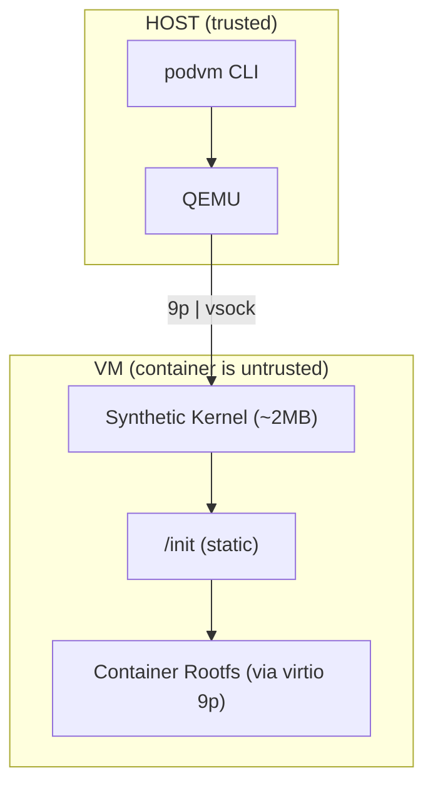

# podvm

> VM-based container runtime with minimal attack surface.

---

## What is podvm?

podvm runs containers in lightweight VMs using KVM, providing hardware isolation without the overhead of full VMs.

**Key features:**
- **OCI compatible** - Use existing container images
- **Minimal kernel** - ~2MB synthetic kernel with minimal attack surface
- **Vsock IPC** - Host↔guest communication via virtio-vsock
- **Uncompressed initrd** - Faster boot, less kernel code
- **No guest runtime** - Container runs directly in VM
- **9p rootfs share** - No host daemon required (virtiofs returns in the
  performance phase; see [ADR-022](adrs/podvm_adr022_9p-rootfs-transport.md))
- **Layered image store** - Content-addressed layers with dedup; pull,
  build, run, `save`/`load` (docker-archive interop with podman) and
  `system prune` all operate on it (see
  [ADR-027](adrs/podvm_adr027_podvm-native-layered-store.md))
- **Podman storage backend** - Runs images podman already pulled, layers
  in place, no export (fallback resolution path; see
  [ADR-024](adrs/podvm_adr024_podman-storage-backend.md))

## Architecture



## Requirements

- Linux with KVM support
- QEMU (`qemu-system-x86_64`)
- libcurl + zlib (host build; registry pull + gzip layers)
- CMake 3.10+
- musl-gcc (optional) for the guest init; falls back to gcc when absent
- 9p + vsock kernel modules for the running host kernel (host-kernel boots
  only; bundled automatically into the initramfs by guest/build-initramfs.sh)

Optional, for the full VM path:
- `/dev/vhost-vsock` on the host (enables the vsock config channel;
  podvm auto-detects it and falls back to the kernel cmdline otherwise)
- A built kernel + initramfs (see below); without them podvm uses the host
  kernel at `/boot/vmlinuz-$(uname -r)`

## Installation

### Build from source

```bash
# Clone repository
git clone https://github.com/your-org/podvm.git
cd podvm

# Build
make

# Install to system
sudo make install
```

### Install locations

```
/usr/local/bin/podvm              # CLI binary
/var/lib/podvm/kernel/            # Kernel + initramfs
/usr/local/lib/podvm/             # Shared libraries
```

### Build guest components

```bash
# Build guest init (musl-gcc if present, else gcc)
make guest

# Build initramfs
make initramfs
```

### Build kernel (optional)

```bash
# Download kernel source
git clone --depth 1 https://github.com/torvalds/linux.git linux-x86_64

# Build with podvm config
cd linux-x86_64
make defconfig
cp ../kernel/config .config
make olddefconfig
make -j$(nproc) bzImage
cp arch/x86/boot/bzImage ../kernel/bzImage
cd ..
```

## Usage

### Basic usage

```bash
# Run a command in a container
podvm /path/to/rootfs /bin/sh

# Interactive mode
podvm -i /path/to/rootfs /bin/sh

# With custom memory/CPU
podvm -m 256 -c 2 /path/to/rootfs /bin/sh

# Named container: the writable layer survives the run (write-back)
podvm -n build alpine /bin/sh

# Pass config into the container (CLI -e beats the image's Env)
podvm -e DEBUG=1 --env-file ./.env alpine /bin/sh

# Discard that state when the run exits
podvm --rm -n build alpine /bin/sh

# ...or remove it on demand
podvm rm build

# Build a Dockerfile into a runnable image (RUN steps boot real VMs)
podvm build -t myapp:1 ./myapp-dir
podvm myapp:1

# Multi-stage builds: FROM ... AS <stage>, COPY --from=<stage|image>.
# -m/-c size the RUN-step VMs (compile steps need real memory).
podvm build -m 2048 -c 2 -t myapp:2 ./myapp-dir
podvm myapp:2

# Run a service in the background, then read its log and stop it
podvm -d -n web -p 18080:80 alpine /bin/sh -c '...'
podvm logs web
podvm stop web
```

Named containers keep their writable layer in
`$XDG_STATE_HOME/podvm/containers/<name>` (defaulting to
`~/.local/state/...`), so writes made inside the container are visible to
the next run with the same name. Unnamed runs are throwaway: writes die
with the VM. One live run per name: a second `--name` run fails fast
(an `flock` serializes them), and `podvm rm` refuses a running name.

### Options

```
Usage: podvm [options] <image|rootfs-dir> [command] [args...]
       podvm rm <name> [<name>...]

Options:
  -i, --interactive   Give the guest stdin exclusively
                      (default: QEMU monitor shares it; Ctrl-A C)
  -d, --detach        Run in the background (requires --name; serial
                      goes to <state>/log; stop with `podvm stop`)
  -e, --env <K=V>     Set an environment variable (repeatable;
                      overrides the image's value for the key)
      --env-file <f>  Read KEY=VALUE lines from a file
  -u, --user <spec>   Run as <name|uid>[:<group|gid>]
  -w, --workdir <dir> Working directory inside the container
                      (absolute; created if missing)
  -p, --publish <spec> Publish a container port to the host:
                      [hostip:]hostport:containerport (tcp)
      --network <mode>  slirp (default) or none (no network)
      --read-only     Mount the container rootfs read-only
  -v, --volume <h:t[:ro]>  Bind-mount a host directory into the
                      container (both paths absolute)
      --tmpfs <dir>   Mount a tmpfs at <dir> in the container
      --hostname <name>  Set the container hostname
  -m, --memory <MB>   Memory in MB (default: 128)
  -c, --cpus <cpus>   CPUs (default: 1)
  -k, --kernel <path> Kernel path
  -r, --initramfs <path> Initramfs path
  -n, --name <name>   Container name; persists the writable layer across
                      runs (write-back). Without it, writes are discarded
                      when the VM exits.
      --rm            Remove the named container's state when the run
                      exits (no-op without --name)
  -h, --help          Show help

Subcommands:
  rm <name>...        Delete named containers' persistent state
  stop <name>...      Stop detached containers
  logs <name>         Print a detached container's serial log
  images              List images in the layered store
  rmi <image>...      Remove images (refused while in use)
  build               Build a Dockerfile into a layered image
  save [-o F] IMAGE   Save an image as a docker-archive tar
  load [-i F]         Load a docker-archive tar
                      (podman/docker save compatible)
  system prune        Remove unreferenced blobs/layers from the store
```

The first positional argument may be a rootfs directory **or** an image
reference (e.g. `debian:12`, `registry.example.com:5000/foo/bar:v1`).
References resolve in order: podvm's native layered store
(`$XDG_DATA_HOME/podvm/store`), then podman's storage, then a pull from
an OCI registry into the layered store on first use. Pulls and builds
land as content-addressed layers with a manifest, so images dedup and
export cleanly (`podvm save`/`load`).

### Examples

```bash
# Run a simple command
podvm /var/lib/containers/storage/overlay/abc123/merged /bin/echo "Hello"

# Interactive shell
podvm -i /var/lib/containers/storage/overlay/abc123/merged /bin/sh

# Run with arguments
podvm /rootfs /bin/ls -la /tmp

# Run as non-root user
podvm /rootfs /bin/id
```

## Development

### Project structure

```
podvm/
├── src/                    # Host-side code
│   ├── main.c             # CLI entry point
│   ├── build.c            # Dockerfile build driver
│   ├── container.c        # Named-container state + locking
│   ├── image.c            # Registry pull + image refs
│   ├── imgcfg.c           # Image config (Env/Cmd/User)
│   ├── json.c             # JSON parser
│   ├── sha256.c           # Content addressing
│   ├── store.c            # Podman storage reader (ADR-024)
│   ├── store_native.c     # Layered image store (ADR-027)
│   ├── tar.c              # ustar/GNU pack/unpack + whiteouts
│   ├── userdb.c           # User/group resolution
│   ├── vsockalloc.c       # Per-VM vsock CID/port allocator
│   └── strparse.{c,h}     # String parsing helpers
├── guest/                  # Guest-side code
│   ├── init.c             # Guest init
│   ├── Makefile           # Build guest init
│   └── build-initramfs.sh # Build initramfs
├── kernel/                 # Kernel config
│   └── config             # Kernel .config
├── tests/                  # Test suite
│   ├── Makefile
│   ├── run_tests.sh
│   └── test_*.c
├── docs/                   # Documentation
│   ├── architecture.md
│   ├── component-boundaries.md
│   └── ...
├── adrs/                   # Architecture Decision Records
├── Makefile                # Top-level build
├── CMakeLists.txt          # CMake build
└── SPEC.md                 # Full specification
```

### Building for development

```bash
# Build with debug symbols
make BUILD_TYPE=Debug

# Build with optimizations
make BUILD_TYPE=Release

# Clean and rebuild
make clean && make
```

### Running tests

```bash
# Run all tests
make test

# Run specific test
cd tests && make test_config && ./test_config
```

### Code style

- C99 standard
- `-Wall -Wextra` enabled
- Static linking for guest init
- Minimal dependencies

## Architecture Decisions

See [adrs/](adrs/) for detailed architecture decisions:

- **ADR001**: Use VMs for isolation
- **ADR002**: Host-side overlay assembly
- **ADR003**: Musl static guest init
- **ADR007**: Synthetic kernel
- **ADR016**: Vsock IPC
- **ADR019**: Virtiofs with QEMU (deferred; see ADR-022)
- **ADR022**: 9p rootfs transport (current)
- **ADR023**: User-mode networking first (current; bridge in the
  performance phase)
- **ADR024**: Podman storage backend (run-path fallback)
- **ADR025**: Escape the config channel (implemented)
- **ADR026**: Host-side write-back for named containers (implemented)
- **ADR027**: Podvm-native layered image store (current)

## Security

### Attack surface reduction

The kernel config minimizes attack surface:

**Included:**
- Virtio PCI, Console, Balloon, 9p
- Vsock
- Namespaces (UTS/IPC/USER/PID/NET)
- Seccomp
- Capabilities
- Security hardening (KASLR, stack protector)

**Excluded:**
- BPF (VM inside kernel)
- Modules (all built-in)
- Tracing/debug subsystems
- Network stack (no guest networking)
- Block devices
- Filesystem drivers (overlay, ext4, etc.)

### Threat model

- **Trust boundary**: Host is trusted, container is untrusted
- **Isolation**: Hardware VM boundary (KVM)
- **IPC**: Vsock (not shared memory)
- **Filesystem**: virtio 9p (host-controlled; virtiofs returns in the
  performance phase per ADR-022)

## Documentation

- [SPEC.md](SPEC.md) - Full specification
- [docs/architecture.md](docs/architecture.md) - Architecture overview
- [docs/component-boundaries.md](docs/component-boundaries.md) - Host vs Guest
- [docs/kernel-attack-surface.md](docs/kernel-attack-surface.md) - Security analysis
- [docs/kata-inspiration.md](docs/kata-inspiration.md) - Kata Containers analysis
- [docs/tests.md](docs/tests.md) - Test suite

## Contributing

1. Fork the repository
2. Create a feature branch
3. Add tests for new features
4. Ensure all tests pass
5. Submit a pull request

## Maintainers

- Steve SCHNEPP <<steve.schnepp@pwkf.org>>

## License

Licensed under the [Apache License, Version 2.0](LICENSE) (SPDX-License-Identifier: `Apache-2.0`).

## See also

- [Kata Containers](https://katacontainers.io) - Similar project
- [Firecracker](https://firecracker-microvm.github.io) - AWS microVM
- [Cloud Hypervisor](https://github.com/cloud-hypervisor/cloud-hypervisor) - Rust VMM
- [OCI Runtime Spec](https://github.com/opencontainers/runtime-spec) - Container runtime spec
