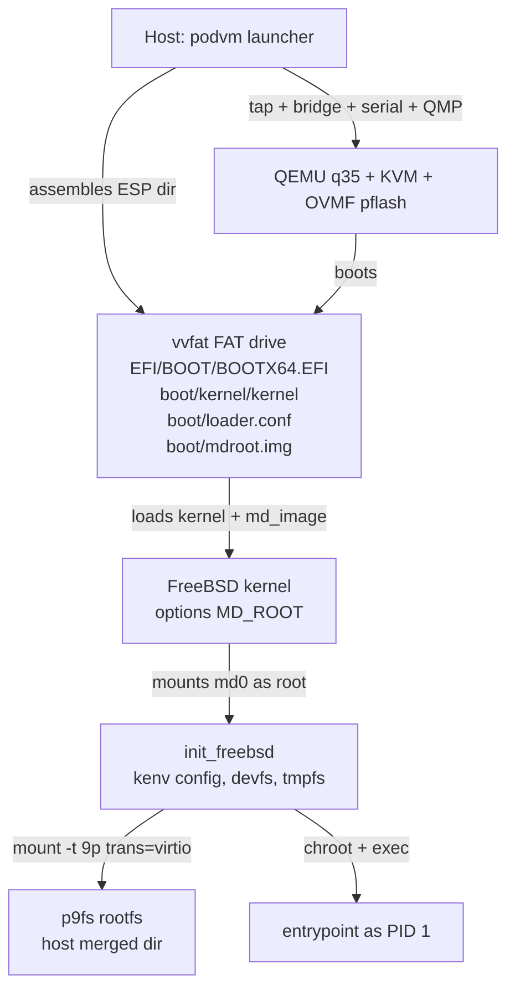

# ADR-021: FreeBSD as a Platform Target (freebsd/amd64)

**Date:** 2026-10-08

**Status:** Proposed

## Context

podvm's design center is a Linux container running directly in a minimal VM: a
synthetic kernel (ADR-007), a musl static init as PID 1 (ADR-003), host-side
overlay assembly (ADR-002), virtiofs rootfs (ADR-019), kernel cmdline/vsock
configuration (ADR-006, ADR-016). Several of these decisions embed Linux
assumptions: QEMU is launched with `-kernel/-initrd/-append` (the Linux boot
protocol), the guest init reads `/proc/cmdline`, and the image layer selects
`os=linux, arch=amd64` from multi-platform indexes (src/image.c,
`select_platform_manifest()`).

The question under evaluation: can podvm run FreeBSD workloads as "containers"?
Docker and friends cannot, because they execute container processes directly on
a Linux kernel and Linux ELF semantics. podvm is different in kind: the guest
kernel is already a per-container parameter, so the guest OS is variable in
principle. The engineering question is how much of podvm is Linux-specific and
whether native FreeBSD mechanisms exist for each podvm building block.

Treating FreeBSD as a different *architecture* (like amd64 vs aarch64) rather
than a bolt-on special case fits the OCI model: the image spec's `platform.os`
field is free-form, registries carry multi-platform indexes, and
`select_platform_manifest()` already implements index-to-manifest resolution.
A FreeBSD OCI image is then simply one more entry in an index, not a new image
format. A native FreeBSD OCI image ecosystem already exists: the daemonless
project publishes base.txz-derived FreeBSD images (base, base-core, nginx,
postgres, ...), and runj (samuelkarp/runj) is an OCI runtime for FreeBSD jails.
These validate the supply side; podvm would supply the *isolation* side on a
Linux host, which jails cannot.

Verified FreeBSD facts (src tree, main branch and releng/15.0, 2026-10):

| podvm building block | FreeBSD status | Evidence |
|---|---|---|
| KVM guest | Fully supported; FreeBSD is a first-class QEMU/KVM guest | -- |
| virtio block/net/console/scsi/balloon | In base | `sys/dev/virtio/{block,network,console,scsi,balloon}` |
| virtiofs client | **Absent** from base | not in `sys/fs` or `sys/dev/virtio` |
| virtio 9p client (p9fs) | **In base, 15.x only** (landed 2024-11) | `sys/dev/virtio/p9fs`, `sys/fs/p9fs`; in releng/15.0, absent in 14.x |
| vsock (AF_VSOCK) | **Absent** from base | no vsock/vmci driver in `sys/dev` |
| initrd / ramdisk root | Yes, via loader preload of `md_image` | `stand/common/module.c` (`load -t md_image`), `sys/dev/md/md.c` (`g_md_init()` scans preloaded `md_image`/`mfs_root`), `sys/conf/options` (`MD_ROOT*`) |
| Direct `-kernel` boot | **Not supported** on amd64 (Linux boot protocol only) | QEMU x86 loader requires Linux headers; FreeBSD boots via its own loader |
| EFI boot | Yes; `loader.efi` reads FAT/UFS/ZFS | `stand/efi/loader` |

## Decision

podvm will treat the guest OS as a platform parameter `(os, arch)` on the same
axis as CPU architecture. `freebsd/amd64` becomes the second supported
platform, selected through the existing OCI index resolution path rather than a
parallel code path. Each platform provides four assets: a kernel, a boot method,
a guest init, and a rootfs delivery mechanism.

For `freebsd/amd64` specifically:

1. **Boot:** OVMF firmware + FreeBSD `loader.efi`, with a per-container ESP
   directory exposed by QEMU vvfat (`-drive file=fat:rw:<dir>`). The loader
   loads the kernel plus an md root image (`load -t md_image`); the kernel
   (built with `options MD_ROOT`) mounts it as root. No per-container disk
   images are created, preserving the host-side assembly model (ADR-002).
2. **Rootfs:** p9fs (virtio 9p) mount of the host-shared merged directory on
   FreeBSD 15.x, mirroring the 9p fallback already present in
   `guest/init.c:mount_rootfs()`. A block-device (assembled UFS/uzip image)
   fallback serves FreeBSD 14.x.
3. **Config:** host-written `loader.conf` in the ESP sets kernel environment
   variables (`podvm.*=` tokens, same names as ADR-006); the guest init reads
   them via `kenv(2)`. This replaces vsock for freebsd guests (no AF_VSOCK
   exists in FreeBSD base).
4. **Guest init:** a FreeBSD port of `guest/init.c` (`guest/init_freebsd.c`),
   statically linked from FreeBSD base libc, running as PID 1.

## Rationale

The platform framing keeps podvm's core promise -- OCI compatibility -- intact.
Multi-platform indexes are normal in the container ecosystem, and an image
containing both `linux/amd64` and `freebsd/amd64` variants of the same service
is a legal, already-supported OCI construct. The alternative (a separate
"FreeBSD image" concept) would fork the image story and forfeit existing
tooling (registries, skopeo, content stores). The change in the image layer is
a platform selector instead of the hardcoded match in
`select_platform_manifest()`.

Every FreeBSD mechanism chosen is base functionality, not a port or a patch.
The md root device chain (`load -t md_image` -> preloaded module -> md(4) ->
rootfs) is a decades-old embedded-boot path with kernel options still maintained
in `sys/conf/options`. p9fs is in the 15.x base kernel and filesystem tree. The
ESP-as-directory trick exploits QEMU vvfat, so the host keeps assembling boot
artifacts in host directories with no image-file lifecycle, exactly as it
assembles the initramfs today. This means the freebsd path depends on nothing
that is not already shipped by QEMU/OVMF and FreeBSD releases.

The host-side delta is small because the virtio device model is shared.
Networking (ADR-009), serial logging (ADR-012), the balloon (ADR-014), memory
backend, and QMP all work unchanged: the FreeBSD guest sees the same virtio
devices the Linux guest does, and virtio-balloon, virtio-console, virtio-net
and virtio-blk are all in FreeBSD base. The guest-side delta is bounded: one
init port of roughly 250 lines (the existing init is ~250 lines and its
structure -- parse config, mount rootfs, chroot, exec -- is POSIX-shaped), one
custom kernel config, and one mdroot image assembly script.

Trade-offs accepted knowingly. Boot latency increases: OVMF adds roughly
300-500ms and the loader another 200-500ms, so time-to-entrypoint moves from
sub-second (linux path) to an expected 1.5-2.5s -- still "container-fast"
versus conventional VMs, but a real regression measured against the Linux
path. The kernel footprint floor rises from ~2MB synthetic to a stripped
FreeBSD kernel of roughly 5-15MB; ADR-007's "virtio-only, audited kernel"
discipline ports conceptually (custom GENERIC derivative, no modules,
MD_ROOT-only root) but not numerically. vsock does not exist for FreeBSD
guests, so ADR-016's IPC gets a platform-specific instantiation: virtio-console
(in FreeBSD base) carries a future guest agent, and the current
config-over-vsock optimization is simply replaced by loader.conf/kenv on this
platform. Finally, p9fs requires FreeBSD 15.x; 14.x users get the block-device
fallback or no freebsd platform support at all.

The security model is unaffected and arguably strengthened where it matters:
isolation still comes from the VM (ADR-001), the host still never executes
guest-provided code, and the guest kernel is still a podvm-built, auditable
artifact rather than a distribution kernel. The attack-surface audit process
documented in kernel/audit.md needs a FreeBSD section, but the process (strip
drivers, no modules, virtio-only) is identical.

## Implications

**Host side.** `start_qemu()` in src/main.c grows a boot-method branch: the
`linux` method keeps `-kernel/-initrd/-append`; the `freebsd` method emits
OVMF pflash (shared read-only), a vvfat ESP drive, and the same serial/QMP
flags. A per-run ESP assembly step (analogous to initramfs assembly) stages
`EFI/BOOT/BOOTX64.EFI`, `boot/kernel/kernel`, `boot/loader.conf`, and
`boot/mdroot.img` into a host directory. The image layer gains a `--platform`
configuration that feeds `select_platform_manifest()`. Kernel assets are
installed per platform under `/var/lib/podvm/kernel/<platform>/`. ADR-005
(shared Podman storage) still holds: FreeBSD images are extracted rootfs trees
in the same content store, so no second image-management path is needed.

**Guest side.** `guest/init_freebsd.c` replaces Linux-specific calls with
FreeBSD equivalents: `kenv(2)` for configuration (mirroring ADR-006 token
names), devfs/fdescfs/tmpfs instead of devtmpfs/devpts, and a p9fs mount
(`mount -t 9p -o trans=virtio rootfs /rootfs`) instead of virtiofs. Shared
parsing code (`strparse.c`) is reused unchanged. The mdroot image is assembled
on the host from FreeBSD base.txz (ADR-002's philosophy applied to a second
platform) and contains only the init, a minimal /etc, and a static /bin/sh for
debugging. The FreeBSD kernel config (custom GENERIC with `options MD_ROOT`,
virtio devices only, no modules) is the platform counterpart of kernel/config,
and kernel/audit.md gains a FreeBSD section.

**Lifecycle and IPC.** Exit semantics match: FreeBSD panics when PID 1 exits,
and with `-no-reboot` QEMU terminates, so the host's wait-for-QEMU loop is
unchanged. ADR-016's vsock agent is Linux-platform-only; the freebsd
instantiation uses virtio-console (`-device virtio-serial` plus chardev) for a
future agent, keeping the message protocol design of ADR-016 intact. Config
delivery needs no IPC at all on FreeBSD: the host writes loader.conf into the
live vvfat directory before boot, eliminating the vsock config race and retry
loop that the Linux path carries. ADR-020's guest overlay module is
Linux-specific and deferred for freebsd: the guest mounts the host-assembled
merged directory read-write via p9fs and `podvm build` layer commits remain a
linux-platform feature until a FreeBSD unionfs/nullfs design is written.

**Performance and operations.** Memory floor rises (a comfortable FreeBSD
guest wants ~100MB vs the Linux path's 128MB envelope, so default `-m` may
differ per platform). Networking works unchanged (ADR-009 tap/bridge; FreeBSD
virtio-net), but the init must configure the interface from kenv tokens
(static or DHCP). CI gains a platform matrix dimension and needs a FreeBSD
image fixture; tests/test_integration must learn that some tests are
platform-scoped. Maintenance cost is one additional init, one kernel config,
and one boot path to keep alive across FreeBSD releases -- accepted as the
price of a second platform.

**Out of scope for this ADR.** freebsd/arm64 (planned beneficiary: it uses the
same EFI+loader boot path, making it cheaper later); running *Linux* images
inside FreeBSD guests via the linuxulator Linux ABI (an attractive future
experiment, but an incomplete ABI); podvm-on-FreeBSD-hosts using bhyve; and
upstreaming virtiofs or vsock drivers to FreeBSD (worth watching, not worth
waiting for).

## Alternatives Considered

**Wait for FreeBSD virtiofs/vsock drivers.** Rejected: no upstream timeline
exists (neither driver is in the tree on main today), and p9fs plus
loader.conf already cover the two use cases. Waiting blocks indefinitely for
convenience that native mechanisms provide now.

**Boot FreeBSD via QEMU `-kernel`.** Not viable: QEMU's x86 direct-boot loader
implements the Linux boot protocol (and multiboot), neither of which the
FreeBSD amd64 kernel provides. UEFI plus `loader.efi` is the only supported
boot path, which is why this ADR standardizes on OVMF for the platform.

**Full disk image per container (qcow2/UFS root).** Rejected as the primary
mechanism: it contradicts host-side assembly (ADR-002), adds image lifecycle
management, and OCI layers are immutable anyway, so live sharing costs little.
Kept only as the 14.x block-device fallback for rootfs delivery.

**PXE / network boot.** Rejected: the loader supports it, but it adds DHCP,
TFTP and a network dependency to the most latency-sensitive phase (boot), and
the bridge network (ADR-009) is not up yet when the loader runs.

**Run FreeBSD userland under the Linux kernel (linuxulator, reversed).**
Rejected as the primary approach: the linuxulator runs Linux binaries on
FreeBSD, not FreeBSD binaries on Linux; there is no FreeBSD-on-Linux-userland
compatibility layer, and emulating the FreeBSD ABI on Linux would be a far
larger project than booting a real FreeBSD kernel.

**Jails on a FreeBSD host (runj-style) instead of a VM.** Rejected: it changes
the host OS and abandons the VM-isolation premise (ADR-001). The podvm value
proposition for FreeBSD is precisely hardware-isolated FreeBSD workloads on a
*Linux* host; on FreeBSD hosts, jails already solve this natively.

## References

- ADR-001 (VMs for isolation), ADR-002 (host-side assembly), ADR-003 (static
  init), ADR-005 (shared image storage), ADR-006 (config tokens), ADR-007
  (synthetic kernel), ADR-009 (bridge networking), ADR-011 (storage locking),
  ADR-012 (serial logging), ADR-014 (balloon), ADR-016 (vsock IPC),
  ADR-018 (QEMU primary), ADR-019 (virtiofs), ADR-020 (guest overlay module).
- FreeBSD src (verified 2026-10 against main and releng/15.0):
  `sys/fs/p9fs`, `sys/dev/virtio/p9fs`, `sys/dev/md/md.c`,
  `sys/conf/options` (MD_ROOT*), `stand/common/module.c` (md_image load),
  `stand/efi/loader`.
- Ecosystem: daemonless/daemonless (native FreeBSD OCI images),
  samuelkarp/runj (OCI runtime for FreeBSD jails).

