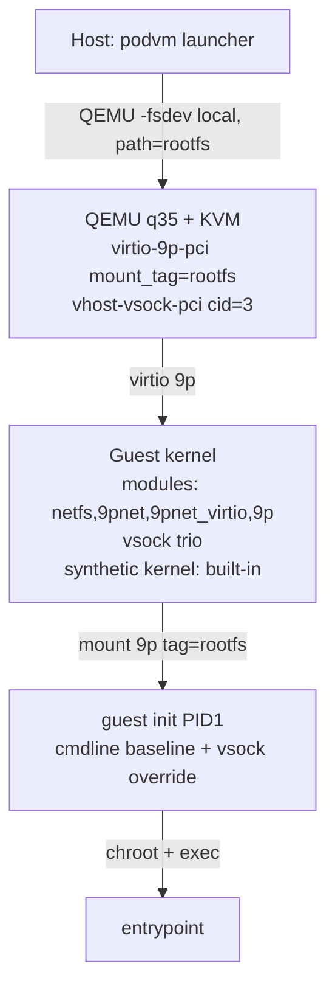

# ADR-022: 9p Rootfs Transport (Temporary; virtiofs Returns at Performance Phase)

**Date:** 2026-10-08

**Status:** Accepted (transitional)

## Context

ADR-019 chose virtiofs (via virtiofsd) as the container-rootfs share between
host and guest. It was never exercised end-to-end: the only environment where
podvm was developed lacks `virtiofsd`, and the test harness's exit-status-only
PASS logic had been masking that absence (fixed 2026-10-08, see mission log
"vsock-fix-oci-pull"). The consequence: the entire VM boot path -- 9p/virtiofs
mount, chroot, exec, vsock handshake -- was untested code. Nothing about
virtiofs was *wrong*; it was simply unprovable on available hardware, and
installing `virtiofsd` was off-limits (no-install rule).

QEMU's 9p support (`-fsdev local` + `virtio-9p-pci`) needs **no daemon**: it
is in-process, ships with every QEMU, and the guest side was already present as
a fallback mount in `guest/init.c:mount_rootfs()`. 9p therefore converts the
"cannot test at all" situation into a testable one at the cost of performance.

## Decision

**Use virtio-9p as the sole rootfs transport until the functional baseline is
green; restore virtiofs afterwards as the default, with 9p retained as a
fallback.** This is a temporary simplification, not a verdict on virtiofs.

Concretely, commits `0a8a186..e478aec` plus `eb4e50d` (host QEMU args, guest
mount, kernel config, tests, e2e boot test) replace virtiofs with 9p.
Reverting that set restores the virtiofs path intact; nothing was rewritten
or discarded.

Details that this decision forced:

- **Guest module bundling.** A KVM guest is a separate kernel instance: the
  host's loaded 9p modules do not count, and the initramfs has no modprobe for
  autoload. When booting the *host kernel* (no synthetic kernel yet), the
  initramfs bundles decompressed copies of `netfs`, `9pnet`, `9pnet_virtio`,
  `9p`, plus the vsock trio (`vsock`, `vmw_vsock_virtio_transport_common`,
  `vmw_vsock_virtio_transport`), and `guest/init.c:load_guest_modules()`
  loads them via `finit_module` in dependency order. The synthetic kernel
  (ADR-007) builds everything in and ships no `/modules`; loading is a no-op
  there.
- **`CONFIG_NET` enters the synthetic kernel.** `CONFIG_NET_9P` depends on
  `CONFIG_NET`, so the "no guest networking" attack-surface property (ADR-007)
  is temporarily relaxed by one net-stack-without-protocols config. Accepted:
  a rootfs transport is a functional requirement, and 9p is the cheapest one
  that needs no host daemon. When virtiofs returns, `CONFIG_VIRTIO_FS=y`
  re-enables and `CONFIG_NET_9P*`/`CONFIG_9P_FS` can move back to the removed
  list, restoring the no-`CONFIG_NET` property.
- **`security_model=none`.** QEMU 9p runs with the invoking uid; podvm is
  single-user-rootfs-served-as-that-uid today. The security-model question is
  deferred to the virtiofs restoration (where virtiofsd's sandboxing options
  apply), and flagged in the followups below.
- **`panic=-1` on the kernel cmdline.** Needed for any automated run: without
  it the kernel hangs after PID1's exec'd process exits, so QEMU never
  terminates and the e2e test cannot assert completion.

## Rationale

The mission-log rule of the project: **the journey is the result in a PoC**,
and an untested boot path is worth nothing regardless of its performance
profile. 9p bought, on the very first boot attempt, two real findings that
virtiofs would have surfaced much later (the `mount()` EINVAL from the
fs_context conversion, and the missing guest vsock transport modules). It also
made the vsock config handshake live-proven for the first time.

Performance was deliberately *not* a criterion here. ADR-019's numbers stand:
virtiofs ~80% of native vs 9p ~50%. That gap matters for `apt-get`/`npm`-style
workloads and is exactly why virtiofs returns before any performance work
begins.

## Implications

- `kernel/config` carries `CONFIG_NET=y`, `CONFIG_NET_9P=y`,
  `CONFIG_NET_9P_VIRTIO=y`, `CONFIG_9P_FS=y`; `CONFIG_VIRTIO_FS` sits in the
  explicitly-removed list with a pointer to this ADR.
- `tests/run_tests.sh` and `tests/test_kernel_config.c` assert the 9p options
  and the presence of host 9p modules instead of `virtiofsd`.
- `tests/e2e_boot.sh` (new) is the project's first real VM boot test: it
  asserts 9p mount -> chroot -> exec -> clean exit, and runs in the standard
  suite when `/dev/kvm` exists.
- ADR-021's FreeBSD path is *strengthened*: p9fs on FreeBSD 15.x now shares
  the primary transport design with Linux instead of being a fallback.
- **Follow-ups when virtiofs returns (performance phase):**
  1. Revert the pivot's code commits newest-first, keeping the e2e test
     and swapping its transport assertion:

     ```
     git revert --no-commit eb4e50d e478aec d0d0f5b 2fb2af7 a9ecd0b 0a8a186
     # restore/adjust tests/e2e_boot.sh, then commit
     ```

     (A plain `git revert 0a8a186..e478aec` also works for the range proper,
     but `eb4e50d` -- the `mount_tag` fix -- landed after the docs and must
     be reverted too.)
  2. Re-add `CONFIG_VIRTIO_FS=y` to `kernel/config`, move `CONFIG_NET_9P*`
     back to the removed list, re-evaluate whether `CONFIG_NET=y` can go.
  3. Restore the memfd-shared memory backend (`-object memory-backend-memfd`,
     `-numa node,memdev=mem`) that vhost-user-fs requires and 9p does not.
  4. Decide the 9p role: delete entirely, or keep as `--fs=9p|virtiofs`
     fallback for virtiofsd-less hosts (ADR-021's FreeBSD guests need p9fs
     regardless).
  5. Revisit `security_model=none` vs virtiofsd's sandboxing.

## Alternatives Considered

**Install virtiofsd.** Rejected: the project's no-install rule forbids it
without explicit user approval, and approval was not sought for what is
ultimately a performance optimization.

**Self-contained test rootfs in the initramfs (skip the fs share entirely).**
Considered as the cheaper first step. Rejected as the *primary* move: it tests
boot + vsock but leaves the rootfs-transport code path -- the thing most
likely to be structurally wrong -- still unexercised. 9p covered strictly
more with modest extra work.

**Ship the 9p modules but keep virtiofs as primary.** Pointless: without
virtiofsd the VM has no rootfs at all, so "primary" would be fiction.

**Bundle 9p as modules in the synthetic kernel instead of building in.**
Rejected: ADR-007's no-modules discipline stands, and the module bundling
above exists only as a host-kernel-boot bridge until the synthetic kernel is
built.

## References

- ADR-007 (synthetic kernel; attack-surface list now carries the temporary
  `CONFIG_NET` entry), ADR-016 (vsock IPC; guest transport modules bundled in
  the same commit series), ADR-019 (virtiofs; superseded-for-now),
  ADR-021 (FreeBSD; p9fs becomes the shared primary transport).
- Mission logs: `2026-10-08_vsock-fix-oci-pull.md` (virtiofsd absence),
  `2026-10-08_pivot-to-9p.md` (this pivot, with restore instructions).
- Kernel: `fs/9p/vfs_super.c` mount path (fs_context conversion, tag as
  mount source), `net/9p/Kconfig` (`NET_9P` depends on `NET`).


