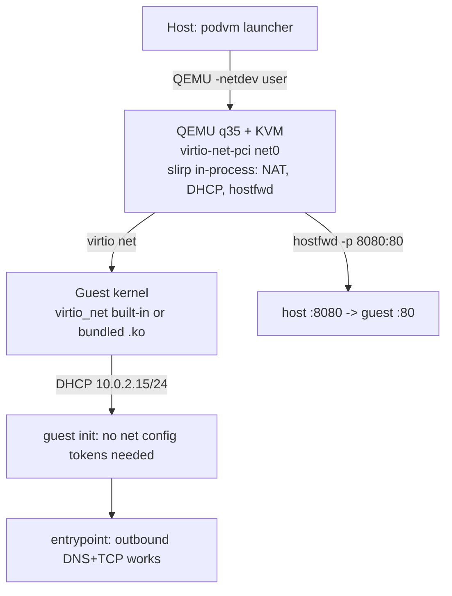

# ADR-023: User-Mode Networking First (bridge Returns at Performance Phase)

**Date:** 2026-10-08

**Status:** Accepted (transitional)

## Context

podvm has no guest networking: `kernel/config` lists `CONFIG_VIRTIO_NET`
under explicitly-removed options, no netdev is attached in
`src/main.c:start_qemu()`, and ADR-009 designs bridge/tap networking
(`podvm0`, 10.89.0.0/24, iptables DNAT port publishing) as the default.
Two things changed that force the question now:

1. ADR-022 brought `CONFIG_NET=y` into the synthetic kernel as a *temporary*
   concession to `CONFIG_NET_9P`. But container workloads need real
   networking eventually (`apt-get`, `npm install`, API calls -- podman has
   it), so `CONFIG_NET` is not temporary; it is a resident. The ADR-022
   wording overpromised a future removal.
2. The 9p pivot (ADR-022) established the project's functional-phase rule:
   **pick the mechanism that needs no host daemon and no elevated
   privileges**, accept the performance cost, and restore the designed
   mechanism when the performance phase begins. Networking should follow
   the same rule rather than being designed-and-implemented up front at
   bridge quality while the rest of the system is still being made
   correct.

ADR-009's bridge model also carries requirements the functional phase does
not need yet: root or `CAP_NET_ADMIN` (bridge + tap creation), host-side
state (the `podvm0` bridge), subnet-conflict detection, and a NAT path.
None of that is required to prove that a guest can resolve DNS and fetch a
package.

## Decision

**Use QEMU's built-in user-mode networking (slirp) as the sole guest
networking transport until the functional baseline is green; restore
ADR-009 bridge/tap networking as the default in the performance phase,
keeping slirp as a fallback.** Same shape as the 9p/virtiofs split in
ADR-022.

Concretely, when networking is implemented:

- **Host:** `-netdev user,id=net0` + `device virtio-net-pci,netdev=net0`.
  In-process, no daemon, no privileges, no host state. Port publishing
  maps `-p 8080:80` to slirp `hostfwd=tcp::8080-:80` in the functional
  phase, preserving the ADR-009/Docker CLI semantics; iptables DNAT
  replaces it later without a CLI change.
- **Guest:** `CONFIG_VIRTIO_NET=y` enters `kernel/config` (removed from
  the forbidden list in `tests/test_kernel_config.c` in the same commit),
  and host-kernel boots bundle `virtio_net.ko` via the existing
  transitive module-bundling path in `guest/build-initramfs.sh` /
  `guest/init.c:load_guest_modules()`.
- **Guest config: none.** slirp's built-in DHCP serves 10.0.2.15/24,
  gateway 10.0.2.2, DNS 10.0.2.3. No new `podvm.*` tokens, no new vsock
  messages, no IP-config code path in the guest init. The config channel
  (ADR-006 cmdline, ADR-016 vsock) is reused untouched when bridge
  networking later needs per-container addresses.
- **`CONFIG_NET` in the synthetic kernel is permanent.** ADR-022's
  follow-up list item about re-evaluating `CONFIG_NET=y` is withdrawn;
  the net *stack* stays, while the attack-surface discipline continues to
  exclude protocols and drivers the guest does not use (no IPv6 unless
  needed, no packet scheduler zoo, no netfilter in the guest -- filtering
  is a host-side concern anyway).

## Rationale

Reusing the 9p pattern buys three things that mattered for 9p and matter
again: it is **testable today** (no install, no privileges, no host
setup), it keeps the **host-side simplicity property** (QEMU is the only
host process; ADR-018's single-binary host story survives), and it
preserves the **revertibility property** (the bridge restoration is a
commit-range revert with a written checklist, like ADR-022's).

slirp's costs are known and accepted: ~50% of native throughput, no
inbound connections without `hostfwd`, no guest-to-guest traffic between
VMs, and TCP through a userspace stack in QEMU. All of that is exactly
the class of cost the performance phase exists to remove, and none of it
blocks functional correctness. ADR-009's own alternatives section already
rejected slirp *as the rootful default* -- that rejection stands; this
ADR only places slirp earlier in the timeline, not in the final slot.

Guest-to-guest communication (the bridge's main structural win) is not a
functional-phase requirement: single-container runs are the current
scope, and inter-VM traffic can ride vsock-mediated host relays or wait
for the bridge.

## Implications

- `kernel/config`'s `CONFIG_NET` comment is corrected: it is no longer
  framed as a temporary 9p concession (ADR-022 amended).
- `CONFIG_VIRTIO_NET` leaves the forbidden list in
  `tests/test_kernel_config.c` in the same commit that adds the netdev;
  until then the forbidden entry is accurate and stays.
- ADR-009 remains Accepted as the performance-phase design; its default
  is deferred, not overturned. Its port-publishing CLI (`-p`) is
  deliberately kept compatible with slirp's `hostfwd`.
- Rootless operation improves incidentally: with slirp, a rootless podvm
  has outbound networking before any rootless-bridge work exists.
- **Restoration checklist (performance phase):** revert the slirp commit
  set (or add bridge alongside it -- prefer a `--network=slirp|bridge`
  flag mirroring the 9p/virtiofs fallback discussion in ADR-022 item 4);
  re-add ADR-009's `podvm0` bridge/tap setup and subnet-conflict
  detection; swap `hostfwd` for iptables DNAT; decide whether the guest
  gets static config via new `podvm.net.*` tokens over the existing
  cmdline/vsock channel (the channel is already there).

## Alternatives Considered

**Bridge/tap from day one (ADR-009 as written).** Rejected for the
functional phase: needs root/CAP_NET_ADMIN, host state, and iptables,
none of which the current single-process host has. It remains the
performance-phase default.

**vsock-carried IP proxy (host side terminates a tun, guests speak a
packet framing over vsock).** Rejected: invents a bespoke data plane
where QEMU ships a maintained one, adds a host daemon-like component
(the very thing the 9p pivot removed), and complicates the vsock
channel's role as a small config/agent IPC (ADR-016).

**No networking at all until the bridge exists.** Rejected: leaves the
OCI story incomplete (images' install steps fail), and forfeits the
cheapest possible test of the guest net stack and virtio-net driver
along the 9p-boot path.

**slirp as the permanent default.** Rejected: throughput and no
inter-container traffic are disqualifying for the performance phase,
and podman parity means bridge semantics eventually.

## References

- ADR-009 (bridge networking; deferred default), ADR-016 (vsock IPC;
  config channel reused when bridge needs per-container config), ADR-018
  (QEMU primary; slirp is QEMU in-process), ADR-022 (9p pivot; the
  mechanism this ADR mirrors), ADR-021 (FreeBSD: virtio-net is in
  FreeBSD base, so this design ports).
- QEMU docs: `-netdev user` (slirp), `hostfwd`/`guestfwd`, built-in DHCP
  range 10.0.2.0/24.
- podman: default bridge `podvm0`-equivalent (`podman0`, 10.89.0.0/24),
  `-p` port publishing semantics targeted for compatibility.

