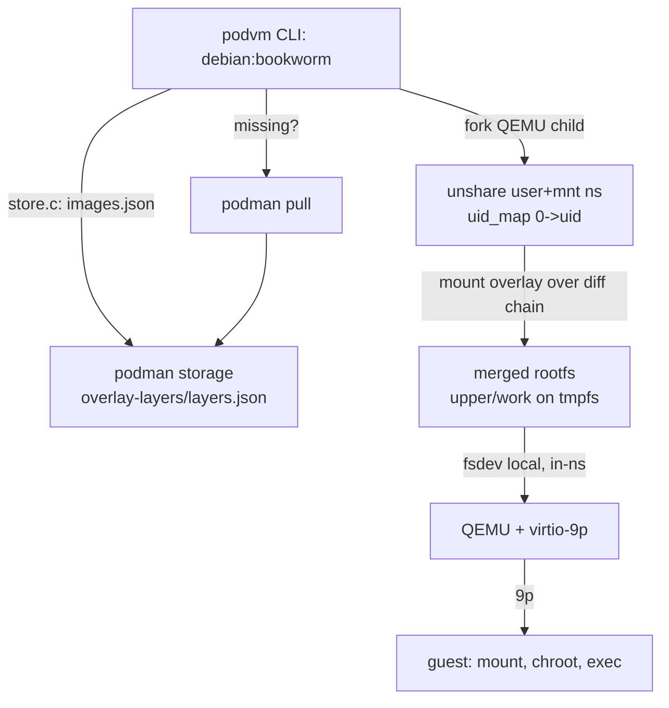

# ADR-024: Podman Storage as Image Backend (Layers in Place)

**Date:** 2026-10-08

**Status:** Accepted

## Context

podvm's own OCI registry client (ADR-005, `src/image.c`) pulls images into a
private cache (`/tmp/podvm/images`). On any developer box, podman has usually
already pulled the same images into `~/.local/share/containers/storage`.
Duplicating pulls wastes time and network, and the podman-built images
(`localhost/munin-dev` and friends) have no registry to pull from at all.

The question: can podvm consume podman's storage directly -- layers in
place, no export step?

Two mechanics had to be verified before committing to this:

1. **Rootless storage is only valid inside a user namespace.** The
   `merged/` dirs podman shows via `podman image mount` are overlay mounts
   living in podman's per-user namespace; from the host namespace they are
   invisible (plain ext4). A QEMU process on the host cannot `-fsdev` them.
2. **The layer chain mounts as a stacked overlay in a fresh userns.**
   Verified empirically on this box: `overlay/<id>/diff` dirs for a 5-layer
   image mount cleanly via `mount(2)` with
   `lowerdir=<chain>,upperdir=...,workdir=...,userxattr` inside
   `unshare(CLONE_NEWUSER|CLONE_NEWNS)`. (Note: the `mount(8)` *binary*
   fails inside the userns -- libmount probing -- but the syscall
   succeeds, which is what C code uses.)

## Decision

**podvm resolves image references against podman's storage first, and the
QEMU child mounts the layer chain itself inside a user namespace.**

- **Resolution order** (`src/main.c`): directory path -> podman storage ->
  podvm's own registry client. The existing OCI client stays as the
  fallback for podman-less hosts.
- **Storage reader** (`src/store.c`): parses
  `overlay-images/images.json` (name -> top layer) and
  `overlay-layers/layers.json` (parent chain), normalizes refs the way
  podman does (`debian` -> `docker.io/library/debian:latest`,
  `localhost/<name>` for local builds).
- **Pull hijack**: if the image is absent and podman exists, podvm runs
  `podman pull` and re-reads the storage. podman becomes the fetch
  mechanism; podvm needs no network code on this path.
- **Userns overlay** (`setup_userns_overlay()` in `src/main.c`): the QEMU
  child after `fork()` does `unshare(CLONE_NEWUSER|CLONE_NEWNS)`, maps
  uid 0 -> invoking uid, makes mounts private, mounts a tmpfs for
  upper/work, mounts the overlay chain at the rootfs path, then `exec`s
  QEMU. The 9p fsdev (ADR-022) serves the merged dir from inside that
  namespace.

**The guiding principle (user's framing): podvm's isolation boundary is the
VM, not the mount plumbing.** Staging files through a userns changes
nothing about the threat model: the guest still sees a 9p share of a
host-controlled directory, and the host kernel + KVM remain the trust
boundary (ADR-001). Rootless podman mounts are *more* constrained than the
direct-host-dir case podvm already accepts.

## Rationale

- **Zero-copy integration.** `podman pull`, `podman build`, and
  `podman run` images work in podvm immediately, with no export dance
  (`podman save`), no registry re-download, and no shared-cache
  configuration.
- **The "hijack" is a feature, not a hack.** Delegating fetch to podman
  means credentials, mirrors, platform selection, and protocol support
  (zstd layers, OCI indexes) are podman's problem, forever.
- **One less daemon.** The overlay mount happens in the QEMU child's
  short-lived userns; no long-running helper holds state (the direction
  set by ADR-022, which removed virtiofsd).
- **Multi-layer chains verified**, including pure-metadata layers and
  the 5-layer local dev images on the reference box; the e2e test
  (`tests/e2e_podman.sh`) runs one of those, not just single-layer debian.

## Implications

- **Kernel config unchanged.** The guest still sees 9p; nothing new in
  `kernel/config`.
- **Storage-format coupling.** `src/store.c` reads containers/storage's
  on-disk JSON. That format is stable in practice (v5 unchanged since
  v1) but is not a public API; a format bump breaks store.c, not the VM
  path. The registry-client fallback covers podman-less systems.
- **`_GNU_SOURCE` + direct syscalls** in `src/main.c` (`unshare`,
  `mount`, uid_map writes). The uid_map/setgroups dance is
  order-sensitive: deny setgroups before gid_map.
- **A real bug fell out immediately:** the e2e test exposed
  `csv_parse` treating space as a separator (`podvm.args=OK
  podvm.env=...` swallowed the env token), fixed with a regression test
  in `tests/test_config.c`.
- **Bisect caveat:** the podman-storage commit series spans
  `301dab4..1c450ef`; the CMake wiring landed last (`1c450ef`), so
  `403223f` alone does not link.
- **Performance phase:** the overlay+userns staging adds a mount and a
  namespace per run. If that ever shows up in profiles, options are:
  pre-mount via a persistent helper, switch the guest to stacked-9p
  (multiple tags), or re-evaluate. Not worth optimizing today
  (ADR-022's "functionally correct first" stance).

## Alternatives Considered

**`podman save --format oci-dir` export.** Rejected as the default: an
export step is exactly the friction the user objected to ("no podman
save"). Kept implicitly possible -- an exported OCI dir is just another
directory podvm could learn to read later.

**Run podvm inside a dedicated podman container** (container-in-container
packaging). Considered as the v1 shortcut for the mount mechanics.
Rejected for now: it adds a packaging layer (image build, device
passes for /dev/kvm and /dev/vhost-vsock, storage bind-mounts) before
the core path is proven, and the in-binary userns approach needed only
~100 lines. Revisit if the userns code grows or needs portability work.

**Host-side overlay mount (no userns).** Not possible rootless: mounting
overlay requires CAP_SYS_ADMIN in the owning userns of the target mount,
which the host user lacks.

**Copy the layer chain into a podvm cache.** Rejected: duplicates data
podman already stores and reintroduces the cache lifecycle ADR-005 tried
to minimize.

**Trust podman's `merged/` dir via `podman unshare` helper process.**
Equivalent in effect, but keeps a podman process alive for the VM's
lifetime and couples podvm to podman's CLI behavior at runtime; the
in-process mount reads only the storage files.

## References

- ADR-001 (VMs for isolation), ADR-005 (OCI image compatibility),
  ADR-022 (9p rootfs transport -- the fsdev served from the userns),
  ADR-023 (user-mode networking; unaffected).
- containers/storage layout: `overlay-images/images.json`,
  `overlay-layers/layers.json`, `overlay/<id>/diff`, `overlay/<id>/lower`.
- Mission log: `2026-10-08_podman-storage.md` (mount-mechanics
  experiments, EPERM/ELOOP findings, the csv_parse catch).

