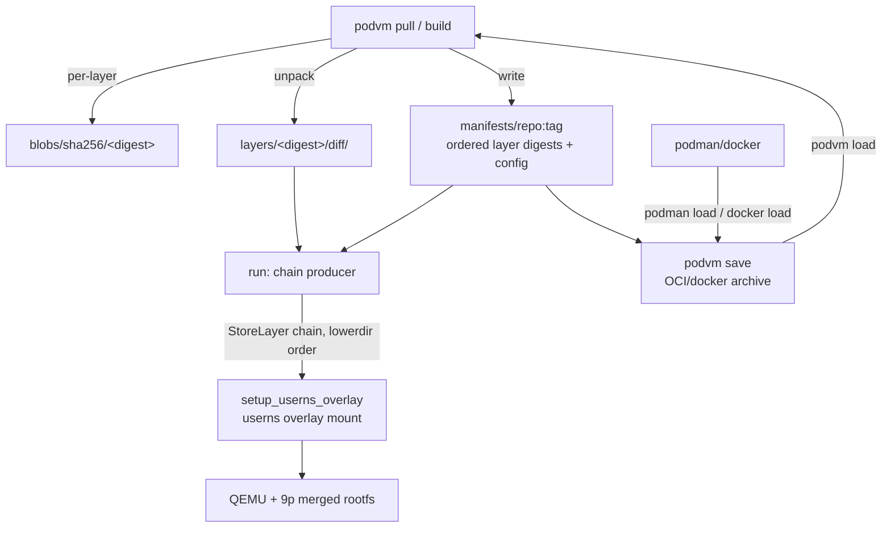

# ADR-027: Podvm-Native Layered Image Store

**Date:** 2026-10-10

**Status:** Proposed

## Context

podvm currently **flattens every image into a single merged rootfs** on
ingest. On pull, the OCI client (`src/image.c`) downloads each layer blob,
decompresses it, and untars every layer into one directory
(`untar_mem(tar, len, root)`). On build, `podvm build` merges the step
uppers into one directory and stores that. What lands in the cache
(`/tmp/podvm/images/<repo>+<tag>/<tag>/`) is one merged filesystem plus an
OCI-shaped `.podvm-config.json` -- there are no layers on disk.

This was a reasonable PoC shortcut, but it is now the limiting factor on
three fronts the project has explicitly committed to:

1. **Waste / dedup.** Two images sharing a base (or two builds sharing
   early steps) each store a full private copy of that base. There is no
   content addressing, so nothing is shared. podman, by contrast, stores
   each layer once by digest and shares it across every image that uses it.
2. **No build cache.** Because a build's intermediate layers are merged
   away, a rebuild cannot reuse a committed step; every RUN re-executes.
   Layer commits are the precondition for a build cache (carried as a next
   step since `2026-10-09_rm-and-run-flags.md`).
3. **No layer identity.** A podvm build of a 3-RUN Dockerfile is 1 layer;
   the docker build of the same file is 3. They cannot be compared at the
   layer level, and `podvm save` (needed to export for comparison or
   `podman load`) has no per-layer material to emit.

Crucially, the *run* path already understands layers: per ADR-024 and
`src/store.c`, podvm reads podman's `containers/storage` layout
(`overlay-layers/layers.json` parent chain, `overlay/<id>/diff` dirs) and
mounts the chain as a stacked overlay inside the QEMU child's userns
(`setup_userns_overlay()`). Only podvm's *own* store loses the layer
structure. The muscle to run a layered image already exists.

The project's stated direction is to be a **podman replacement**, and the
user has directed that podvm keep layers rather than flatten ("the
flattening has served its course").

## Decision

**podvm's own image store becomes a podvm-native, layered,
content-addressable store.** Layers are stored as sha256-addressed blobs
and unpacked per-layer directories; an image is a manifest that references
an ordered list of layer digests plus an image config. Pull (on the
native-client path) and build keep their layers instead of merging them.
`podvm run` stacks the manifest's layer chain through the existing overlay
path. Interop with podman/docker is via `podvm save` / `podvm load`
(OCI/docker archive), **not** a shared live store.

The store root moves from the ephemeral `/tmp/podvm/images` cache to a
persistent `$XDG_DATA_HOME/podvm/store` (default
`~/.local/share/podvm/store`), because dedup and a build cache are only
worth having if they survive reboots.

## Rationale

- **Dedup and a build cache fall out of content addressing.** A layer is
  stored once under its digest; every image and every build step that
  produces identical content references the same blob. Rebuilding a
  Dockerfile can stop at the first unchanged step (its digest already
  present). This is the whole reason to keep layers.
- **The run path is already layered.** `store.c` + the userns overlay
  mount consume an ordered chain of unpacked `diff` dirs. The new store
  simply produces that chain for podvm's own images instead of only for
  podman's. Minimal new machinery at run time.
- **podvm-native, not containers/storage.** The user explicitly chose full
  control over byte-level podman compatibility for podvm's *own* store.
  Reimplementing containers/storage's write side in C (id computation,
  `images.json`/`layers.json` mutation, locking, atomicity) is a large,
  corruption-prone surface. A small, digest-keyed layout under podvm's
  control avoids that while keeping the same *model* (layers + manifest).
- **Interop is preserved where it matters.** `podvm save` emits a standard
  OCI/docker archive (single or multi layer) that `podman load` and
  `docker load` accept, and `podvm load` ingests one. So podvm images move
  in and out of the podman/docker ecosystem through the well-defined
  archive boundary, without coupling the live stores.
- **This is the podman-replacement trajectory.** Keeping layers is the
  precondition for push/pull against registries with real layer identity,
  for `save`/`load`, for a build cache, and for comparing a podvm build to
  a docker build -- all of which a flattened store cannot support.

## Implications

- **`src/image.c` (native pull) changes**: instead of untarring all layers
  into one root, it stores each decompressed layer as a digest-addressed
  blob + unpacked dir, records the chain in a manifest, and writes the
  config as a blob. The flatten path is retired on this route.
- **`src/build.c` changes**: each RUN commit becomes a real layer (diff of
  the step upper, whiteouts preserved as overlay char 0:0 devices) added
  to the manifest, instead of merging into one upper. This also unblocks
  the build cache and multi-stage later.
- **New store module** (`src/store_native.c` / `.h`, working name):
  content-addressable blobs, per-layer unpack, manifest read/write,
  digest-keyed GC, and a chain-producer that feeds `setup_userns_overlay`
  in the same `StoreLayer` shape `store.c` emits. `store.c` (the podman
  reader) is retained for ADR-024 interop; the two are sibling backends
  behind the same run-path interface.
- **Disk layout / migration**: the existing flattened cache entries have no
  layers to recover; they are invalidated and re-pulled/re-built into the
  new store (acceptable for a `/tmp` cache that re-pulls). The new store is
  persistent, so GC (a future `podvm system prune`) becomes meaningful.
- **`podvm save` / `podvm load`** become the interop surface; `podvm images`
  lists manifests (with layer counts) from the new store.
- **ADR relationship**: refines ADR-005 (OCI compat) and ADR-024 (podman
  storage). ADR-024's *read-podman-in-place* path is kept for interop; its
  rationale line rejecting "copy the layer chain into a podvm cache" is
  about duplicating data podman already holds, not about podvm keeping
  layers for its own builds -- this ADR governs the latter. ADR-020 (guest
  overlay module) remains narrowed/superseded-for-run by ADR-026; layer
  *commits* for build now happen host-side against this store, so ADR-020's
  guest-module premise stays retired.

## Alternatives Considered

**containers/storage-compatible store (podman's on-disk format).** Rejected
for podvm's *own* store: the write side (content-addressable ids,
`images.json`/`layers.json` mutation, atomic updates, locking) is a large,
easy-to-corrupt surface to reimplement in C, and it couples podvm to
podman's internal format as a *writer* (ADR-024 only reads it). Podman
interop is achieved through `save`/`load` archives instead.

**OCI content-addressable layout (`blobs/sha256` + `index.json` +
`oci-layout`) as the live store.** Strong, standard choice, and the
closest to "podman replacement" via native OCI. Chosen *against* for the
live store in favor of a minimal podvm-native layout under full control;
however, `podvm save`/`podvm load` still speak the OCI/docker archive, so
the standard is honored at the boundary. Revisit if native OCI push/pull
becomes a goal.

**Keep flattening; only add `podvm save`.** Rejected: save would emit a
single-layer archive (no real layer identity), and it fixes export while
leaving the underlying waste, missing build cache, and dedup gap untouched
-- the exact problems the user flagged.

## References

- ADR-005 (OCI image compatibility), ADR-020 (guest overlay module --
  narrowed by ADR-026), ADR-022 (9p rootfs transport),
  ADR-024 (podman storage backend -- the layered *read* path and the
  userns overlay this store feeds), ADR-026 (host-side write-back).
- `src/store.c` / `src/image.c` / `src/build.c` -- the code this evolves.
- `specs/01_LAYERED_IMAGE_STORE.md` -- the implementable design.
- Mission logs: `2026-10-08_podman-storage.md` (overlay chain + userns
  mount), `2026-10-09_rm-and-run-flags.md` session 5 (build's current
  merge-commit).

